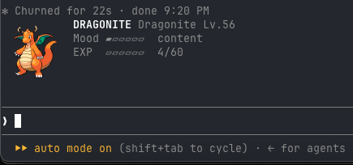
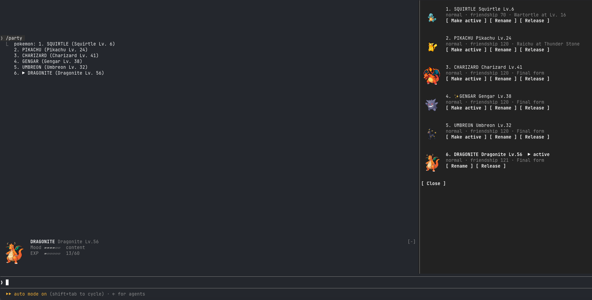

# Pokémon mod for Claude Code

A Pokémon party above your Claude Code prompt. Pick a starter, meet a wild Pokémon every hour, and level up your active Pokémon with Claude's tool calls. Pokémon evolve by level, stone or friendship.





## Install

At the prompt of a Claude Code terminal session, type:

```
/plugin install pokemon --marketplace gabrielminoru/pokeclaude
```

Answer `y` to add the marketplace, then pick a scope (user scope loads it in every session). It's active right away: Professor Oak appears above the prompt, so choose your starter.

## Development

To run it from a local copy instead:

1. Clone this repository: `git clone https://github.com/gabrielminoru/pokeclaude.git ~/pokeclaude`
2. Open `~/.claude/settings.json` and add this line inside `"env"` (create the `"env": { }` block if it isn't there):
   ```json
   "CLAUDE_CODE_PLUGIN_DIRS": "~/pokeclaude"
   ```
   If you already have a `CLAUDE_CODE_PLUGIN_DIRS`, append `:~/pokeclaude` to it instead.
3. Start a new Claude Code session (`claude`). Edits to the folder reload while it runs.

To try it once without touching settings, run `claude --plugin-dir ~/pokeclaude` instead of step 2.

## Requirements

- **Sprites** show as images in **Ghostty** or **kitty**. Other terminals, tmux and the desktop app show a `[Charmander]` text badge instead.
- **`curl`**, plus network access to `pokeapi.co` and `raw.githubusercontent.com`. Sprites and data download on first use and are cached in `~/.claude/plugins/data/pokemon/`.

## Commands

| Command | What it does |
|---|---|
| `/pokemon` | Active Pokémon's stats, your party, and all subcommands |
| `/pokemon keep [nickname]` / `letgo` | Answer a wild encounter |
| `/pokemon stop` / `evolve <species>` | Stop an evolution, or pick a branch |
| `/pokemon switch \| release \| nick <slot\|name>` | Manage your party (slots 1–6) |
| `/pokemon gen <1–9\|all>` / `region <name>` | Which generation the wild encounters come from |
| `/pokemon hide` / `show` | Hide or show the display above the prompt |
| `/party` | Open the party pane with all six sprites; type it again (or press Close) to close it |
| `/pokedex` | Seen, caught, shinies |
| `/pokedex seen` / `caught` / `<number>` | The species you have seen or caught, and one of them by number |
| `/bag` / `/bag use <stone> <slot\|name>` | Evolution stones |

## How it plays

- **EXP:** every successful tool call Claude makes gives EXP to your active Pokémon. It gets excited (×1.5 EXP) with lots of activity and bored (×0.75) after 3 idle hours.
- **Wild encounters:** one per hour while you have a free slot (party max 6). Shinies are 1 in 256.
- **Stones:** an evolution stone can turn up every few hours.
- **No harm:** nothing can make your Pokémon faint.

Your party is saved per machine.

## Generations

Wild encounters come from **Kanto (Generation I)** by default — the 151 species of the first games. `/pokemon gen` shows the one in play, `/pokemon gen 3` or `/pokemon region hoenn` switches to another, and `/pokemon gen all` brings every species back.

The Pokédex counts against the generation in play, so it can actually be finished: `Seen 12/151 · Caught 4/151` in Kanto, out of the 1025 species of the whole dex.

## The Pokédex

`/pokedex` counts what you have seen and caught. `/pokedex seen` and `/pokedex caught` list the species themselves, in the order of the Pokédex, and `/pokedex <number>` asks about one of them:

```
$ /pokedex caught
Caught (4): Charmander, Gengar, Eevee, Dragonite

$ /pokedex 25
#025 Pikachu — seen
```

## The card

Each Pokémon carries its own numbers, read from PokeAPI: its type, its base stats and its ability. The party pane shows them on a card of its own, one per Pokémon, and `/pokemon` prints the active one's in full.

## Legal

This is an unofficial fan project, not affiliated with or endorsed by Nintendo, Game Freak, The Pokémon Company, or Anthropic. Pokémon and Pokémon character names are trademarks of Nintendo, Game Freak and The Pokémon Company.

The code ships no Pokémon artwork: sprites are downloaded at runtime from [PokeAPI](https://pokeapi.co/). The screenshots above show Pokémon sprites © Nintendo / Game Freak.

The code is released under the [MIT License](LICENSE). The license covers the code only, not Pokémon names, data or artwork.
